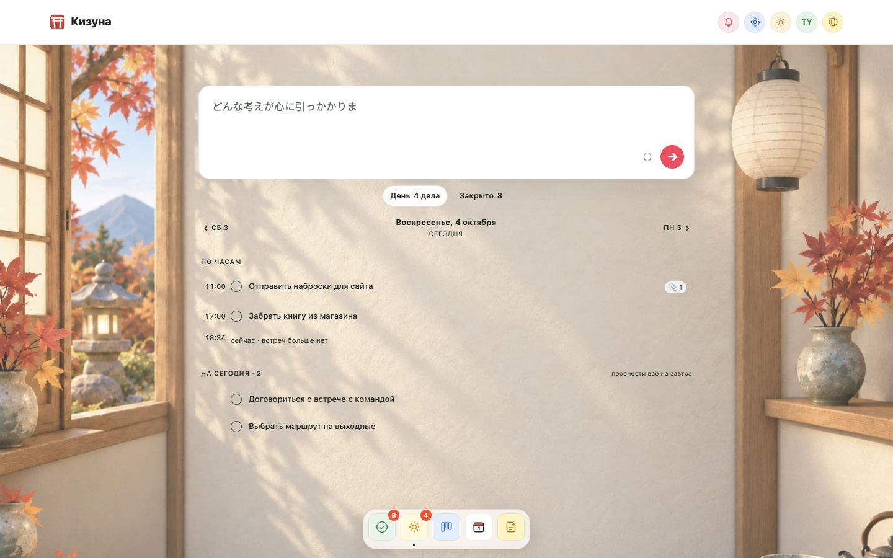

# Кизуна

Кизуна — ежедневник, в который можно писать так, как вы говорите.

> Завтра в 11 созвон с Аней, а смету надо отправить сегодня.

Кизуна разберёт эту фразу на два дела. Смета появится в списке на сегодня, а созвон с Аней — в плане на завтра в 11:00.

**[Попробовать Кизуну в браузере →](https://yourkizuna.com/)** · Можно начать сразу после регистрации.

[](https://yourkizuna.com/)

## Что можно сделать в Кизуне

- **Спланировать день.** В «Сегодня» встречи стоят по часам, а у дел без точного времени есть отдельный список. Идею, к которой хочется вернуться позже, можно сохранить в «Заметках».
- **Попросить о помощи.** Пригласите человека в общий круг и напишите «Ане — прислать смету до пятницы». Аня сможет ответить «Беру», а вы увидите просьбу у себя в «Я жду».
- **Вспомнить, что успели.** Нажмите кружок рядом с готовым делом. В «Сделано» можно посмотреть, что вы закрыли сегодня и какие встречи прошли за неделю.

## Когда мысль пришла на ходу

**В Telegram** перешлите сообщение подключённому боту, чтобы превратить его в дело. Позже его можно найти прямо в чате. [Как работает поиск](docs/telegram-task-search.md)

**На Mac** нажмите ⌘⇧Пробел, пока Кизуна запущена. Откроется маленькое окно для записи, и дело появится в том же ежедневнике. [Скачать Кизуну для Mac](https://yourkizuna.com/public/mac-download.html)

## Запуск из исходников

Для запуска понадобится Node.js, например версии 22 или 24.

```sh
git clone https://github.com/mcoder33/kizuna.git
cd kizuna
npm ci
cp .env.example .env
npm run dev
```

Откройте `http://127.0.0.1:3000` и создайте локальную учётную запись. Базовый режим работает без API-ключа. Для разбора записей языковой моделью подключите провайдера. Данные хранятся в SQLite в `data/pagent.sqlite`.

[Настройки сервера](.env.example) · [Сборка для macOS](desktop/macos/README.md) · [Документация проекта](docs/) · [Архив прототипов и решений](https://github.com/mcoder33/kizuna/blob/874c579bcf30410c40d8bf82aacb5d88549f46cf/README.md)
