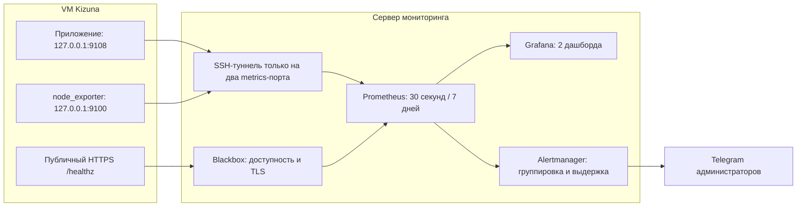

# Grafana, метрики VM и Telegram-алерты

## Схема и покрытие

На 2026-10-04 read-only проверка Kizuna VM подтвердила 2 CPU, 3 910 МиБ RAM, около 2 402 МиБ MemAvailable, 48 ГиБ доступного диска, systemd 259 и Node 22.22.1. Grafana/Prometheus/exporters и Docker не установлены; Kizuna работает, `/healthz` ещё отвечает 404 до выкладки PR логирования. Это снимок, а не постоянная оценка ресурсов.

Для размещения выбран предложенный VPN-сервер `46.226.167.34`. Read-only проверка на 2026-10-04: 1 CPU, 1 971 МиБ RAM, 1 614 МиБ MemAvailable, 26 ГиБ свободно, systemd 245, Docker 26.1.3. Работают AmneziaWG в Docker и native Hysteria; Docker Compose plugin отсутствует. Их конфигурация, маршруты, firewall и службы не менялись. У Hysteria не настроен ACL; поэтому пароль на API нужен даже при bind на loopback, который может достигаться через proxy. Лимиты ниже рассчитаны на этот хост; обычное потребление нужно дополнительно проверить после запуска под реальной VPN-нагрузкой. На VM Kizuna остаются только loopback listener метрик приложения и node_exporter. Grafana + Prometheus + Alertmanager + Blackbox работают отдельно. Тогда публичный HTTPS probe продолжает проверять доступность, когда VM Kizuna упала. Поддержан также `--mode colocated`; на одной VM после её падения отправить алерт будет некому.



| Дашборд | Основные показатели |
| --- | --- |
| `kizuna-flow` — флоу и производительность | Доступность, API RPS/5xx/p95, время операций и зависимостей, очередь/lease/ожидание, успехи/fallback/ошибки, полученные клиентские этапы, время ввода и видимого результата, RSS/heap/CPU/event loop, потери логов, активные алерты и доставка |
| `kizuna-vm` — VM | Uptime, CPU/steal/iowait, load/CPU count, MemAvailable/RAM/swap, свободные байты и inode, IO throughput/await/busy, сеть/ошибки/drop, OOM, часы и Linux pressure |

Обе VM различаются по `instance`: `kizuna-vm` и `monitoring-vm`. Labels не содержат пользователей, capture/flow ID, содержимое туду, модель, credentials или URL зависимостей. Шаблоны маршрутов/операции ограничены бюджетом уникальных labels. `source/surface` и provider имеют фиксированные значения. Метрики в памяти переживают scrape, а `increase/rate` учитывают сброс при рестарте процесса. Prometheus сохраняет агрегаты на своём диске. Полный путь конкретной записи остаётся в JSONL и читается `logs:report` по ID.

Клиентские этапы показывают полученные события/попытки, а не уникальных людей и не строгую конверсию. Квоты, offline и закрытие страницы дают пропуски; accepted на сервере и succeeded подтверждают сохранение/разбор. Histogram p95 — оценка по buckets; точные сохранённые длительности есть в JSONL. Ошибки JS/rejection и частые ошибки отправки web/Mac также имеют отдельные пороги алертов (>=3 за 10 минут; отправка дополнительно >20% полученных submit). Внешнее HTTP-время измеряет получение заголовков, операции включают чтение ответа. Telegram long polling/SSE исключены из правил API latency.

## Правила алертов

37 правил в `ops/monitoring/rules.mjs` проверяют:

- Публичную недоступность от 2 минут; отсутствие app/VM metrics и самого probe; старый runtime sample.
- API: минимум 3 ответа 5xx за 5 минут и доля >5% с выдержкой 2 минуты; p95 >2 секунд при >=10 запросах за 5 минут с выдержкой 5 минут.
- Очередь: старейшее pending >60 секунд в течение 3 минут, просроченные lease 2 минуты; failed processing attempt за 15 минут; fallback >30% при >=10 завершениях за 10 минут с выдержкой 5 минут. Намеренный `fallback` без причины не деградация.
- Интеграции: >=3 диагностических отказов за 10 минут; event loop p95 >200 мс; новые потери/ошибки логгера; повторные рестарты; TLS меньше 14 дней.
- VM: CPU >85% / steal >20% 10 минут; RAM <15% 5 минут / <8% 2 минуты; диск <15% 5 минут / <5% или <1 ГиБ 2 минуты; прогноз заполнения, inode <10%, OOM, отклонение часов >30 секунд, IO busy >90% 10 минут.
- Сам мониторинг: доступность Grafana, список администраторов/синхронизация/reload, ошибки вычисления PromQL и отправки в Telegram.

Пороговые значения — начальная политика; после первой недели данных их нужно сверить с нормальным профилем. Нет данных не превращается в зелёный статус. Корневая недоступность подавляет связанные симптомы; critical подавляет warning только в том же домене (RAM не скрывает проблему диска). Группировка по service/instance/category/domain/severity, начальная задержка 30 секунд (critical 10), повторы warning раз в 4 часа, critical раз в час, `send_resolved:true`. Для деплоя/работ предусмотрены silences в Alertmanager, исключения не зашиты в приложение.

Telegram по умолчанию выключен. `settings.json` перечитывается каждую минуту; отключение Telegram применяется при следующем tick и reload. После `--enable-telegram` `admin-sync` раз в минуту читает приватный `/alert-recipients` с Bearer token на том же loopback-порту 9108 через SSH-туннель. Без token file endpoint отвечает 503, без правильного Bearer — 401. Файл на Kizuna VM читается при каждом запросе, поэтому его установка/смена не требует рестарта приложения. В списке — **каждый активный admin** с `telegram_links.chat_id > 0`, совпадающим с `telegram_id` (личный чат). `user`, pending/blocked/rejected, группы и некорректные связи исключены. Снятие роли/блокировка/отвязка удаляет получателя при следующей успешной синхронизации и reload Alertmanager. Роли Kizuna не открывают доступ к Grafana автоматически.

Последний подтверждённый список хранится на bounded filesystem мониторинга, в `admin-sync/admin-recipients.json` с `0600`; он переживает рестарт и используется при падении приложения/VM/туннеля. Поэтому отозванная роль может временно оставаться получателем, пока приложение недоступно; следующая успешная синхронизация удаляет её. Успешный пустой список выключает отправку; при первом старте без cache и недоступном приложении получателей нет. Неполный/некорректный ответ не заменяет cache. Отдельные алерты показывают отсутствие Telegram-связи, пустой список, устаревшую синхронизацию и ошибку reload. Личные chat IDs остаются только в приватном ответе/cache/Alertmanager config, не в логах, labels или dashboard.

Alertmanager отправляет отдельное сообщение в каждый личный чат, включая восстановление (`send_resolved:true`), через bot token из файла. Можно использовать уже подключённого бота Kizuna: на внешнем сервере выполняется только исходящий `sendMessage`, без `getUpdates` и зависимости от процесса приложения. Для отдельного monitoring bot каждый администратор должен сначала запустить его в личке; наличие связи с основным ботом не доказывает право нового бота писать. Токен не передаётся в CLI, не хранится в git и не синхронизируется публичным endpoint. Шаблон содержит VM/имя алерта, действие и ссылку; HTML parse mode отключён. `--telegram-chat-id` оставлен как ручное положительное personal-ID override для диагностики, в штатной конфигурации получатели автоматические.

Если сам Telegram/бот не доставляет, алерт о его отказе может не прийти по тому же каналу: остаются график ошибок доставки и проверка оператором. Для падения сервера мониторинга нужен независимый watchdog/второй канал; он здесь не настроен.

## Хранение и доступ

Контейнеры закреплены: Prometheus 3.15.0, Alertmanager 0.34.1, Blackbox 0.28.0, Grafana 13.2.3; node_exporter 1.12.1; admin-sync Node 22.22.1-slim. Проверены официальные releases и загрузка образов. Клиент метрик — поддерживаемый `@prometheus-io/client` 0.16.1; он требует Node 22/24/26+, что соответствует проверенному Node 22 на VM и CI. Node 20 больше не входит в runtime-контракт.

Шесть контейнеров на VPN VM ограничены суммарно **1 312 МиБ RAM и 0,70 CPU**: Prometheus 512/.25, Grafana 512/.25, Alertmanager 96/.05, Blackbox 64/.05, node_exporter 64/.05, admin-sync 64/.05 (МиБ / CPU). SSH unit дополнительно имеет MemoryMax 32 МиБ. Grafana имеет дополнительный GOMEMLIMIT 384 MiB (цель для Go GC, не hard RSS limit). Это верхние ограничения, а не измеренное обычное потребление; оставлен запас для ОС и VPN. Node exporter на Kizuna VM отдельно ограничен 96 МиБ / 10% одного CPU. Docker daemon/VPN не перезапускаются при установке monitoring stack.

`install-storage.sh` на выбранном сервере создаёт отдельный ext4 filesystem **6 ГиБ** из заранее выделенного файла. До выделения требует минимум 10 ГиБ свободно, не форматирует существующий образ и не монтирует поверх данных. Внутри — Prometheus, Alertmanager, Grafana. TSDB: 7 дней / 1 GB; head/WAL/compaction включены в границу filesystem. Заполнение этого тома может остановить мониторинг, но его данные не займут весь root filesystem. Docker image cache хранится отдельно; автоматическое удаление образов не настроено.

Docker stdout: до 3×5 MB на контейнер (6 сервисов, до 90 MB суммарно). Namespace journal мониторинга: 32 MiB / 7 дней, отдельный от других служб; активный journal может превышать бюджет одним файлом. Grafana/TSDB/data dirs имеют права под UID контейнеров. Secret-файлы находятся вне git и имеют `0600`: Grafana password UID 472, Telegram token UID 65534. Отключённые Telegram-конфиги не читают токен, пустой файл всё равно нужен для bind mount.

Prometheus, Alertmanager (включая injection/reload API) и Blackbox требуют Basic Auth с bcrypt через exporter-toolkit `web.yaml`; Grafana требует отдельный login и тот же service password для `/metrics`. Prometheus scrape/alerting, Grafana datasource и admin-sync reload читают service password из secret files. Пароль не передаётся в argv; datasource получает его через Grafana FILE/env provider и secureJsonData. admin-sync не имеет доступа к bot token. VM/exporter и admin-sync `/metrics` содержат только агрегаты/характеристики машины и не имеют API управления или chat IDs.

Все service ports привязаны к `127.0.0.1`: app 9108, Kizuna VM 9100, VPN VM 9101, admin-sync 9102, Prometheus 9090, Alertmanager 9093, Blackbox 9115, Grafana 3001. Открывать их в firewall не нужно. Grafana открывается через SSH-туннель оператора или отдельный HTTPS origin с Caddy и входом. Внешний HTTPS origin нужно одинаково задать в render `--grafana-url` и `MONITORING_GRAFANA_URL`, secure cookie включить для HTTPS. Anonymous/sign-up выключены.

## Запуск после одобрения

1. Для инфраструктурного релиза установить `announce:false` в release manifest, затем выложить приложение и ограничение journal обычным GitHub deploy workflow (без пользовательского объявления). Проверить `/healthz`, `curl http://127.0.0.1:9108/metrics`, JSONL и стабильность службы. `PAGENT_METRICS_PORT=off` отключает listener; неверный порт тоже отключается. Ошибка listener/scrape логируется и не останавливает продукт.
2. На Kizuna VM установить agent (`bash ops/monitoring/install-agent.sh` из одобренной версии): скачивание официального tar, SHA256, отдельный system user, loopback unit. Нужны root, curl/tar/sha256sum и systemd >=245. Также установить recipient token из шага 5 в `/opt/kizuna/alert-recipients-token` с `0600`, owner `kizuna:kizuna`; для другой локации есть `PAGENT_ADMIN_ALERTS_TOKEN_FILE`. Это отдельное ops-действие; текущий deploy.sh сам exporter не ставит.
3. На VPN-сервере `46.226.167.34` установить только Docker Compose plugin для уже установленного Docker (без рестарта Docker daemon) и скопировать `ops/monitoring` в `/opt/kizuna-monitoring`. Запустить одобренный `install-storage.sh`. Системные пути намеренно фиксированы; installer не запускался на production.
4. Для отдельного сервера создать отдельный forwarding-only SSH user/key. `authorized-key.example` запрещает команды/TTY и разрешает только destinations 127.0.0.1:9108/9100. В `sshd_config` Match User дополнительно задать `AllowTcpForwarding local`, `MaxSessions 0`, `PermitTTY no`, `AllowAgentForwarding no`, `X11Forwarding no`. Перед reload проверить `sshd -t` и сохранить доступ текущего оператора. В `/etc/kizuna-monitoring` поставить root-owned key/known_hosts (`0600`), `tunnel.env` с `KIZUNA_SSH_HOST`, и unit `metrics-tunnel.service`. Fingerprint сверить независимо; не использовать автоматический trust неизвестного ключа.
5. Установить CLI `openssl` и `htpasswd` (`apache2-utils`, без Apache daemon), затем запустить одобренный `bash /opt/kizuna-monitoring/install-auth.sh`. Он создаёт случайные 256-bit service/recipient/Grafana credentials, bcrypt web config, сохраняет существующие credentials при повторе и ничего секретного не печатает. Установить тот же `admin_recipients_token` на Kizuna VM по SSH/secret manager с указанным выше owner/mode; bot token записать в свой secret file закрытым вводом. При ротации файлов пересоздать контейнеры (`docker compose ... up -d --force-recreate`), чтобы обновить file bind mounts и Grafana FILE/env. Создать config: Render использует Node 22/24/26+; на VPN VM можно выполнить его одноразовым контейнером Node (не устанавливать Node глобально). Outputs — YAML-compatible JSON, dashboard JSON и шаблон Telegram. Не класть реальные токены/chat IDs в git.

```sh
node /opt/kizuna-monitoring/render.mjs --output /opt/kizuna-monitoring/config --mode external
# Для одной VM: --mode colocated; SSH unit не нужен.
# Для личных алертов каждому активному админу добавить --enable-telegram
# На VPN VM без Node: docker run --rm --network none -v /opt/kizuna-monitoring:/app -w /app node:22.22.1-slim node render.mjs --output /app/config --mode external --enable-telegram
# Токен не аргумент CLI. config/alertmanager должен принадлежать 65534:65534.
# config/settings.json задаёт enabled/mode/приватный recipient endpoint; сам список приходит из приложения.

# /etc/kizuna-monitoring/stack.env (без секретов)
# MONITORING_CONFIG_DIR=/opt/kizuna-monitoring/config
# MONITORING_DATA_DIR=/opt/kizuna-monitoring/data
# MONITORING_SECRETS_DIR=/etc/kizuna-monitoring/secrets
# MONITORING_GRAFANA_URL=http://127.0.0.1:3001

# Secret-файлы создаёт оператор, через закрытый ввод/secret manager:
# grafana_password: chown 472:472, chmod 600
# telegram_bot_token: chown 65534:65534, chmod 600 (пустой, если Telegram выключен)
# admin_recipients_token: chown 65534:65534, chmod 600; такой же token на Kizuna VM
# web_password: root:65534, chmod 640; web.yaml: 65534:65534, chmod 600
# install-auth.sh выполняет генерацию и выставляет эти права.

# Установить monitoring.service, daemon-reload, затем enable --now после проверки mounts/secrets.
# Открытие Grafana на машине оператора:
ssh -N -L 3001:127.0.0.1:3001 root@46.226.167.34
# http://127.0.0.1:3001; отдельная учётная запись Grafana.
```

До включения реальных Telegram-уведомлений проверить `promtool check config`, `amtool check-config`, все scrape targets, оба дашборда, mount и ресурсы. Затем по отдельному запуску проверить один тестовый firing/resolved каждому подключённому активному админу, доступ получателей и silence. Ни конфигурация, ни локальная проверка сами не отправляют сообщения людям.

## Проверки и источники

`npm run monitoring:check` запускает pinned promtool/amtool в Docker с `--network none`: валидирует 37 правил и конфигурации без/с Telegram, проверяет восемь временных сценариев (недоступность, выдержка/восстановление очереди, RAM обеих VM, реальные 5xx, низкий трафик, намеренный fallback, устаревание/восстановление списка админов). Без credentials smoke проверяет 401 для Prometheus, injection/reload Alertmanager и Grafana metrics. Unit-тесты проверяют метрики/единицы/labels/приватность/replay/limits, приватный endpoint, Bearer auth/отсутствие токена и фильтрацию ролей/чатов, cache при отказе/рестарте, отзыв получателей и retry reload. `npm run monitoring:smoke` поднимает pinned stack в отдельной локальной Docker-сети с локальными probe/Telegram заглушками, проверяет provisioning обоих дашбордов, PromQL всех панелей, scrape targets, автоматических админов и отдельную доставку firing/resolved двум получателям **заглушки** Telegram; screenshots/result сохраняет в ignored `tmp/monitoring-smoke-*/`; путь последнего успешного прогона — `tmp/monitoring-smoke-latest.json`. Не запускает install scripts и не отправляет сообщения людям.

Схема не включает Loki: Grafana показывает агрегаты, оператор читает retained JSONL для разбора отдельного флоу. Production-выкладка и установка на VPN VM не выполнены. В read-only production снимке найден 1 активный администратор и 1 корректная личная Telegram-связь; token и реальные chat IDs не выгружались. Реальная доставка требует token secret и проверки после одобренного запуска. Независимый watchdog для самого monitoring host не настроен.

Первичные источники: [Prometheus storage](https://prometheus.io/docs/prometheus/latest/storage/), [Alertmanager Telegram/routing](https://prometheus.io/docs/alerting/latest/configuration/), [Grafana provisioning](https://grafana.com/docs/grafana/latest/administration/provisioning/), [node_exporter collectors](https://github.com/prometheus/node_exporter), [SSH restrictions](https://man.openbsd.org/sshd_config), [Node metrics client](https://github.com/prometheus/client_js), [Prometheus web auth](https://prometheus.io/docs/prometheus/latest/configuration/https/), [Hysteria outbounds/ACL](https://v2.hysteria.network/docs/advanced/Full-Server-Config/).
