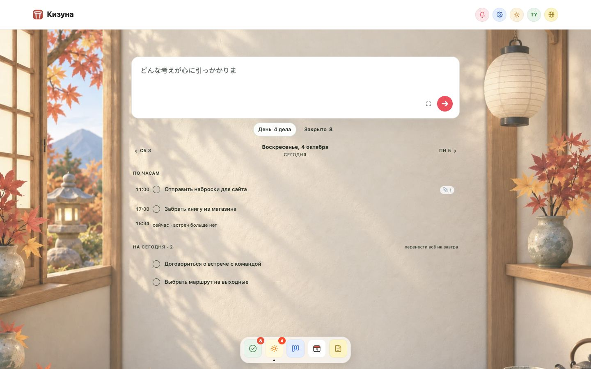
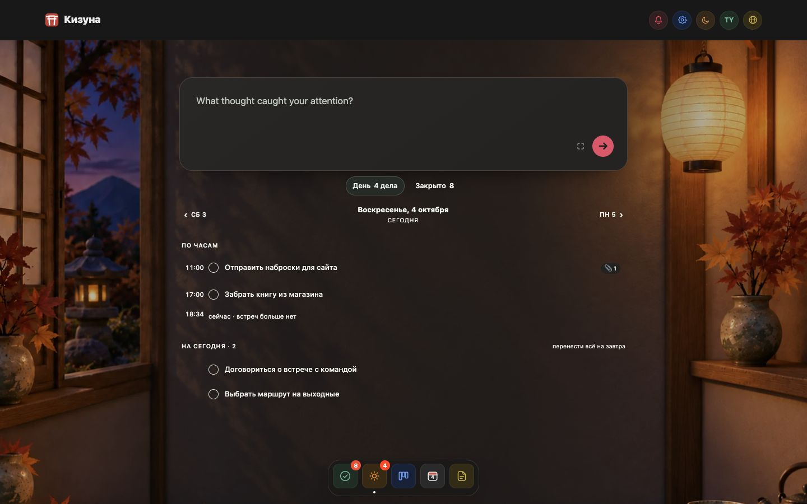
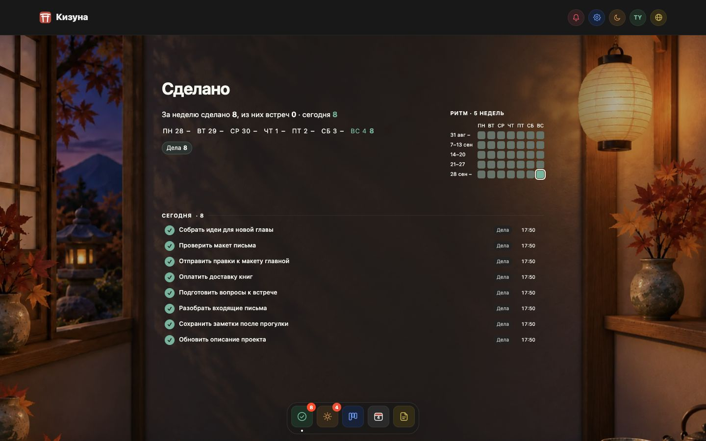
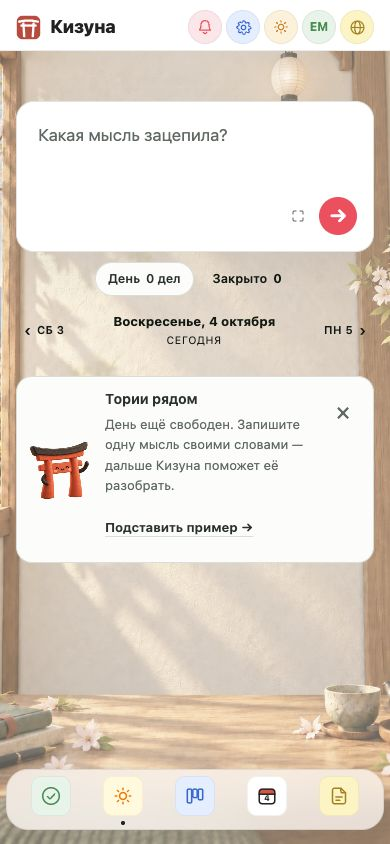
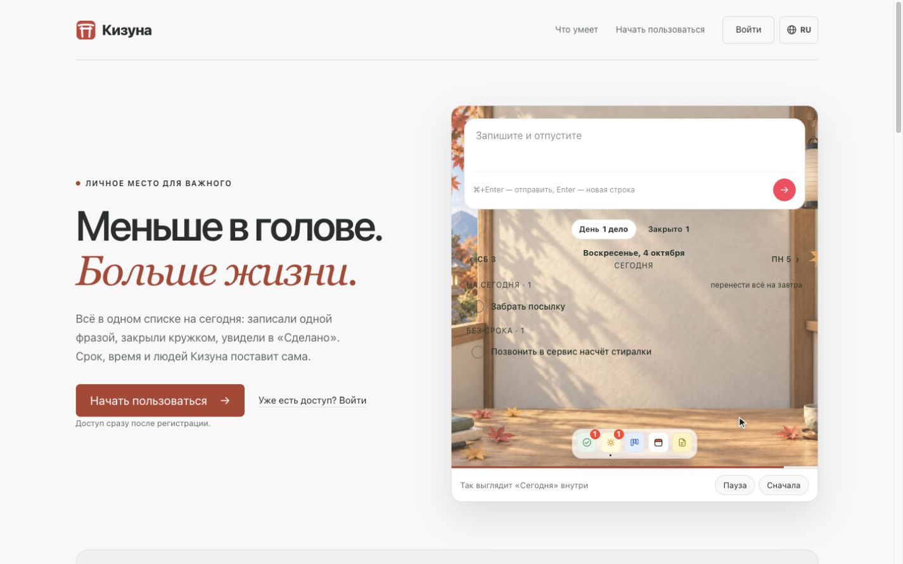
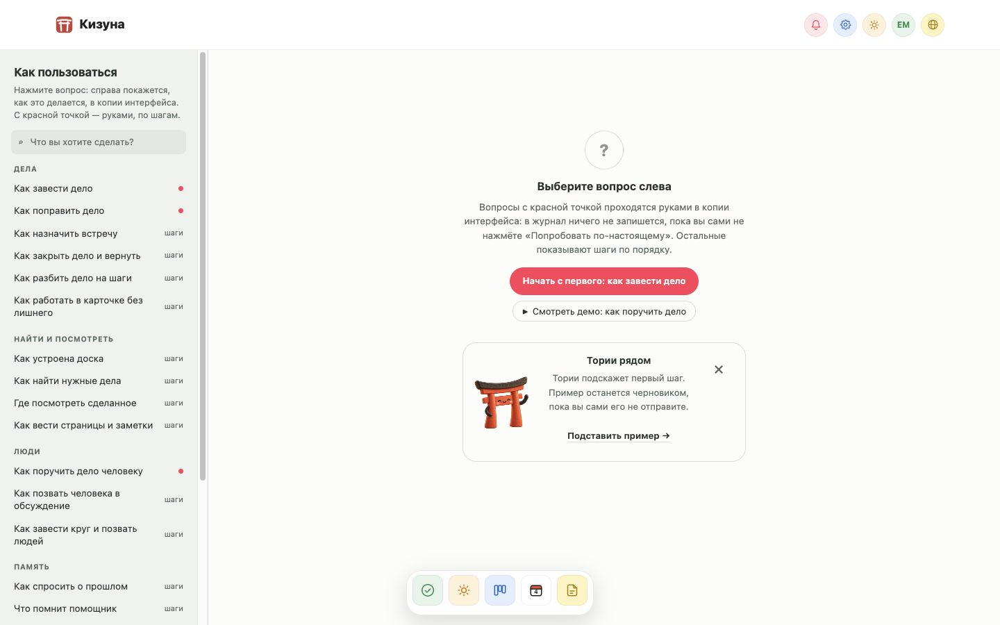

# Мастерская: реализация оформления Кизуны

Первый выпуск был доступен только coder33 через allowlist. Общий выпуск открывает Мастерскую для всех и делает её оформлением по умолчанию при наличии доступа. Явный выбор classic сохраняется. Поправка связывает комнату с темой интерфейса и исправляет контраст встреч и подписей.

## Принятые решения

- Сохранены исходные форма ввода, её размеры, расширение, редактирование и навигация.
- «Сегодня» и «Сделано» используют открытые списки любой длины на фоне комнаты. У строк нет отдельных коробок; при большом числе дел не появляется непрозрачная панель.
- Доска, календарь, заметки, карточка записи, настройки, справка, круги и административные экраны используют согласованные рабочие поверхности.
- «Обзор / Отчёты» не возвращён в навигацию. Актуальный раздел — «Сделано».
- Светлая тема показывает дневную комнату, тёмная — тихую мастерскую. Системная тема следует устройству. Время суток не меняет фон; автоматически меняется только сезон. Доступен ручной выбор сезона.
- Тории помогает в пустых состояниях. Подсказки можно скрыть, выключить и восстановить. Пример заполняет только пустой черновик и не отправляется автоматически.
- На публичной главной комната находится внутри демонстрации продукта. Основной текст, вход и загрузка приложения остаются на спокойном фоне.

Исторический консилиум: 6 циклов, 13 вариантов, 6 отборов на промежуточных стадиях и 7 отклонений. Окончательное направление — C6-B «Тихая мастерская», после последующих поправок к открытым спискам. Промежуточный отбор не означает согласование пользователем или готовность к выпуску.

[Все исторические макеты и причины решений](../design/workshop/history.html) · [Структурированный журнал](../design/workshop/history.json).

## Настройки и доступ

Все новые значения синхронизируются существующим `/api/ui-preferences`, отдельно для каждого аккаунта. Существующий `pagent.theme` сохранён.

| Ключ | Значения | По умолчанию |
|---|---|---|
| `kizuna-appearance` | `classic`, `workshop` | `workshop` при доступе, иначе `classic` |
| `kizuna-room-season` | `auto`, `winter`, `spring`, `summer`, `autumn` | `auto` |
| `pagent.theme` (существующий) | `light` → день, `dark` → ночь, `system` → тема устройства | `system` |
| `kizuna-torii-hints` | `enabled`, `disabled` | `enabled` |
| `kizuna-torii-dismissed` | JSON-массив идентификаторов подсказок | пусто |

Сервер возвращает `capabilities.workshopAppearance` и добавляет право доступа в исходный HTML. Недоступная Мастерская отрисовывается как classic; сохранённый выбор аккаунта не удаляется. Запись `workshop` без доступа получает 403. Такой отказ не блокирует очередь остальных настроек.

| `PAGENT_WORKSHOP_MODE` | Поведение |
|---|---|
| отсутствует / `off` / неизвестное значение | Выключено; публичные страницы classic |
| `allowlist` | Только UUID из `PAGENT_WORKSHOP_USER_IDS`; публичные страницы classic |
| `all` | Доступ всем авторизованным аккаунтам; публичные страницы в новом стиле |

Список UUID разделяется запятыми или пробелами. Ошибка в любом элементе закрывает доступ всему списку. Внешнее оформление остаётся отдельным пользовательским выбором даже при разрешённой возможности.

Первый выпуск был включён только для coder33 через allowlist. Общий выпуск использует `all`, включая публичную демонстрацию. Анонс разрешён пользователем и отправляется после проверки общего доступа. Старый ключ `kizuna-room-light` принимается сервером для совместимости с прежними клиентами, но новое оформление его не читает и не показывает отдельный переключатель освещения.

## Комнаты и поведение

Дневной свет всегда соответствует светлой теме, тихая мастерская — тёмной. В системном режиме используется `prefers-color-scheme`. Часы и переходы летнего времени не выбирают освещение. Сезоны автоматического режима соответствуют Северному полушарию: декабрь–февраль, март–май, июнь–август, сентябрь–ноябрь. Это явно объяснено в настройках; ручной сезон доступен независимо от времени суток.

Картинка декодируется до появления. При первой ошибке загрузки остаётся нейтральная поверхность; при ошибке следующего сезона сохраняется уже показанная комната. Во время загрузки другого освещения и при ошибке этой загрузки используется нейтральная поверхность текущей темы, чтобы не смешивать дневной интерфейс с ночным фоном. Изображения не запрашиваются в classic. Компактные композиции используются до 1100 px.

Автоматическая смена сезона откладывается во время ввода, IME, удержания указателя, HTML-перетаскивания, открытой карточки/диалога и скрытой страницы. После завершения действия применяется актуальный выбор. Одно освещение допускает мягкую смену сезона. Изменение темы обновляет освещение сразу, включая фокус в черновике или открытый диалог; содержимое черновика сохраняется. При reduced motion переход отключён.

Поставляются 16 WebP-комнат и один персонаж: всего 2 201 332 байта, самая большая картинка — 164 892 байта. Манифест фиксирует источники отобранных рисунков, размеры и фактические байты; тест проверяет полноту и бюджет каждой картинки.

Новые фразы переведены на все семь языков приложения. Подсказка в календаре не появляется при выключенных источниках; на доске и в заметках учитываются поиск и фильтры. В справке персонаж расположен внутри начального состояния, сохраняя компоновку раздела.

## Web и Mac

Главное окно Mac получает те же HTML/CSS. Отдельное окно быстрой записи получает вычисленные цвета, шрифты, радиус и отступы через существующий `CaptureAppearance.js`; параллельного хранения оформления нет.

Проверены светлая, тёмная и системная темы, оба оформления и сохранность черновика. В автономном WKWebView тестовый стенд имитирует видимость страницы: без цикла обычного приложения WebKit сообщает `document.hidden=true`. Production runtime и bridge не подменяются. Эти проверки не заменяют будущую проверку установленной релизной сборки.

Нативный тест проверяет вычисленный контур кружков выполнения отдельно от токена. Фоновый CLI-процесс WebKit не продвигает CSS-переходы; перед сравнением конечного кадра тест завершает переходы через Web Animations API. Production CSS использует общие токены и не содержит обхода этой особенности тестового стенда.

## Верификация

Поправка после первого выпуска: `npm test` — 907/907, браузерные сценарии Мастерской — 10/10, реальный WKWebView — PASS. Проверены light/dark/system, старый выбор света игнорируется, локальные границы сезонов, отсутствие влияния часов, загрузка всех восьми комнат на двух ширинах, смена темы с открытым черновиком и восстановление после ошибки загрузки. Реальные встречи (прошлая, текущая, будущая), их источники и метки срочности проверены в 390/1440 px × light/dark: вычисленный контраст не ниже 4.5:1. Четыре свежих кадра прошли независимый визуальный просмотр.

| Проверка | Результат |
|---|---|
| Полный `npm test` | 907/907 PASS |
| Новые браузерные сценарии + вход | 8/8 PASS |
| Существующая синхронизация настроек + вход | 7/7 PASS |
| Ширина, высота, координата X, отступы и радиус ввода | Точное совпадение classic/workshop в 8 сравнениях: 1440/960/390/375 × light/dark |
| 8 комнат × desktop/mobile | Картинки декодируются, горизонтального переполнения нет |
| Конец длинного списка | Последняя строка выше дока во всех 8 проверках |
| 7 разделов × day/night × desktop/mobile | 28 реальных кадров; переполнение 0, ошибка картинки отсутствует |
| Публичные главная/вход/загрузка × desktop/mobile | 6 кадров; комнаты за текстом страницы нет |
| Нативные capture/theme/bridge проверки | PASS |
| Реальный WKWebView: classic/workshop × light/dark/system, контуры списка и черновик | PASS, с ограничениями тестового стенда выше |
| Mac сборка arm64, подпись и DMG checksum | PASS |

Дополнительный общий браузерный прогон: 187 PASS, 14 FAIL, 1 SKIP. На исходной версии `9e26a9f` воспроизведены 13 тех же ошибок: семь сценариев старого `#capture-hint`, две проверки текущего дня/брифа, один сценарий подзадач, два сценария календаря с отсутствующей SQLite-функцией в тестовом подключении, один неоднозначный locator ссылки загрузки. Ещё одна ошибка была гонкой ожидания resize в тесте синхронизации: ожидание заменено на проверку конечного значения, весь файл после этого проходит. Общий набор не объявляется полностью зелёным.

Независимое визуальное ревью — PASS для показанных состояний, включая свежие подсказки и два нативных кадра. Формальная сертификация доступности и проверка всех комбинаций данных не заявляются.

## Повторить локально

```sh
npm ci
npm test
PAGENT_WORKSHOP_MODE=all E2E_PORT=3047 E2E_FAKE_PORT=3147 PAGENT_E2E_DB=/tmp/kizuna-workshop-e2e.sqlite npm run test:e2e -- tests/workshop.spec.js tests/ui-preferences.spec.js
node tests/fixtures/workshop-preview.mjs
bash desktop/macos/Tests/test-capture.sh
bash desktop/macos/Tests/test-workshop.sh
bash desktop/macos/build.sh
```

Локальный сервер работает только на `127.0.0.1:8901`, использует отдельную тестовую базу, вымышленные данные и отключённую внешнюю сеть. Пример: `/__preview?profile=many&route=today&season=winter&theme=dark`. Профили `empty`, `typical`, `many`; наполненные профили включают вымышленные календарные встречи и подзадачи для проверки подписей; оформление `appearance=classic|workshop`; гостевая главная — `/__public`.

## Снимки реализованных экранов








Результат поставляется для ревью через отдельную ветку и PR. Слияние, выкладка и Telegram-объявления требуют отдельного распоряжения пользователя.
